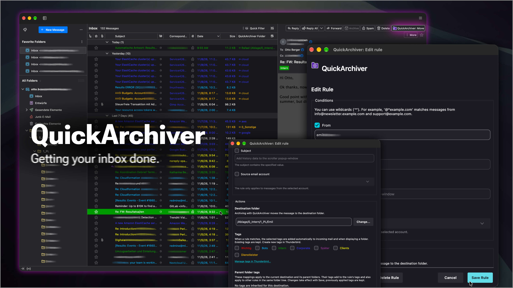
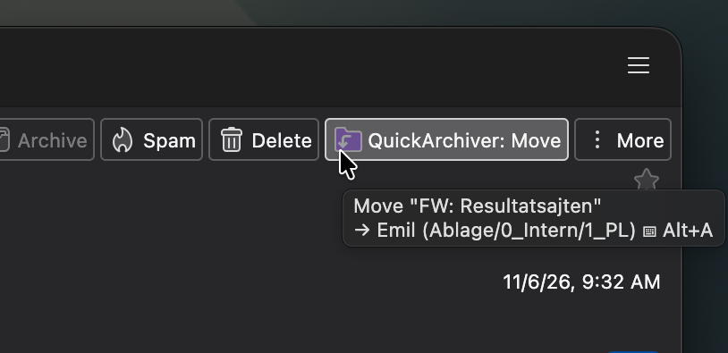
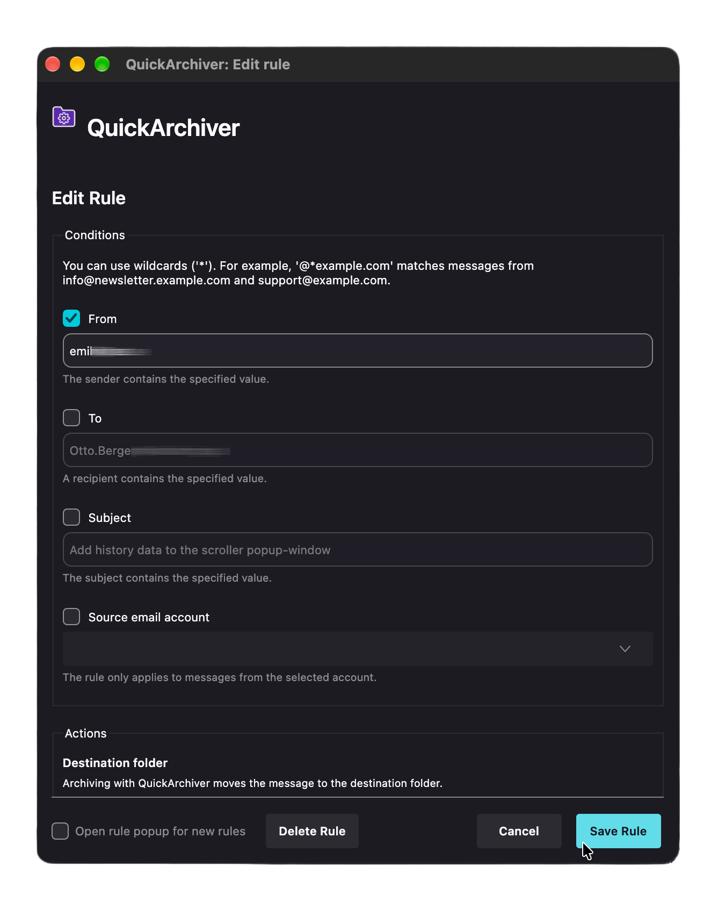
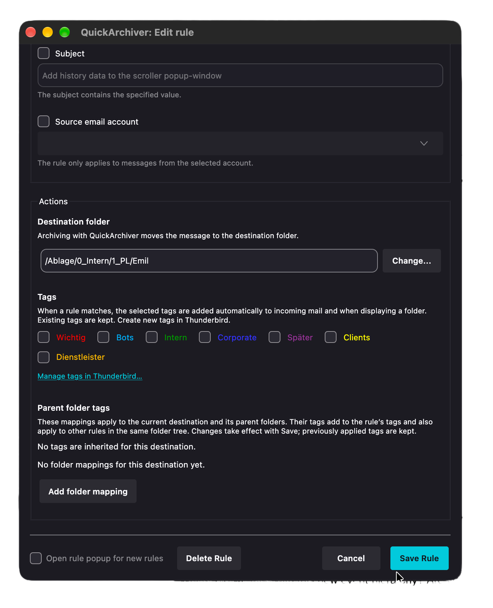
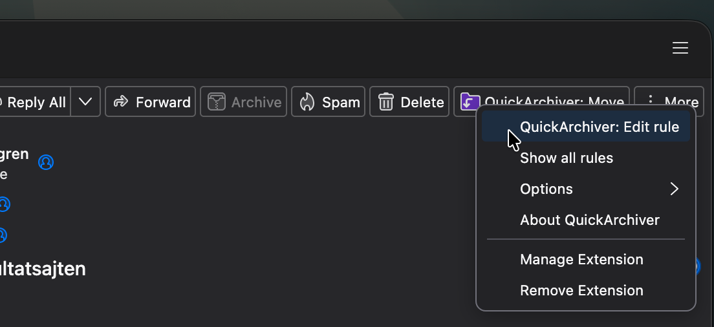
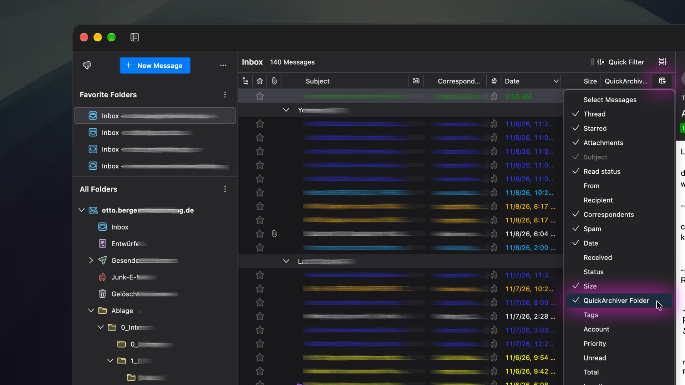
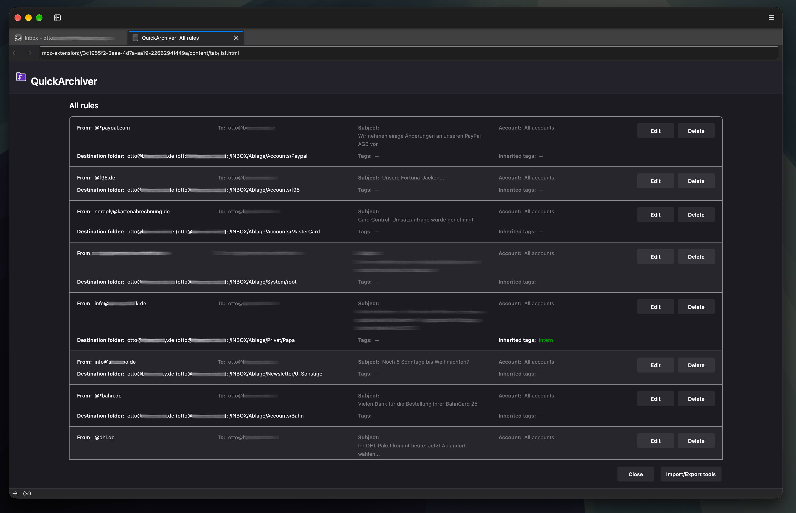

#  QuickArchiver



QuickArchiver is a Thunderbird MailExtension for keeping your inbox clean. It learns destination folders when you
move messages and later archives matching messages with one click or a keyboard shortcut.
**NEW:** It also **automatically tags messages based on your rules**, keeping categories visible
even before you move messages out of your inbox.

QuickArchiver supports an email workflow based on the **Getting Things Done (GTD)** method: once you have decided
what to do with a message, quick filing helps you keep your inbox clear.

## Project status

- Current version: **2.8.1**
- Manifest: **V3**
- Supported Thunderbird versions: **128 through 160**
- Languages: **English, German, and French**
- License: **GNU Lesser General Public License, version 3 or later**

The current release uses Thunderbird's supported MailExtension APIs and a small custom column experiment for the
QuickArchiver folder column and opening Thunderbird's tag settings. Rules are stored locally in WebExtension storage
and can be backed up as JSON.

Install the published release from [Thunderbird Add-ons](https://addons.thunderbird.net/thunderbird/addon/quickarchiver/).

## Features

### Move messages to the right folder

- Automatically creates a rule when a message is moved to a folder
- Moves matching messages through the toolbar button, context menu, or **Alt+A**
- Provides a searchable destination-folder picker with account filtering
- Shows matching destinations in the optional QuickArchiver folder column

### NEW: Automatically tag messages based on rules

- Automatically applies existing Thunderbird tags to messages matching your rules, including incoming mail
- Keeps categories such as **Customers**, **Invoices**, or **Project A** visible while messages are still in your inbox
- Adds tags inherited from destination folders and their parent folders
- Shows direct and inherited tags in the rule dialog and rules overview
- Preserves existing message tags; you choose when to move messages to their destination folders

See [Automatic tagging](#automatic-tagging) for setup and examples.

### Shared rules and management

- Matches sender, recipient, and subject conditions for both filing and tagging
- Supports case-insensitive text matching and `*` wildcards
- Optionally restricts a rule to a source account
- Lists, edits, and deletes stored rules
- Imports and exports all rules as JSON
- Optionally opens the rule editor whenever a new rule is created

## Quick start

### 1. Create a rule by moving a message

Move a message to its destination folder as usual. If no matching rule exists, QuickArchiver automatically creates
one from the sender address and remembers the destination folder.

### 2. Archive matching messages



When a message matches a rule, click the QuickArchiver button or press **Alt+A**. QuickArchiver moves it directly to
the saved destination folder. With multiple messages selected, Alt+A moves each message for which a rule exists.

> **Tip:** In Thunderbird's table view, enable the **[QuickArchiver Folder](#Folder-column)** column to see the matching destination
> before moving a message.

### 3. NEW: Add automatic tags

Edit the rule and select one or more Thunderbird tags under **Actions → Tags**, then save it. QuickArchiver
automatically adds those tags to matching incoming messages while they are still in your inbox. You can also
assign tags to destination folders and their parent folders to share categories across multiple rules.

For example, tag a supplier's messages as **Invoices** on arrival, then move them to the saved supplier folder
with **Alt+A** when you are ready. See [Automatic tagging](#automatic-tagging) for the full guide.

## Rule details



The rule editor supports these conditions:

- **Sender:** matches the sender address
- **Recipient:** matches any recipient address exposed by Thunderbird
- **Subject:** matches the message subject
- **Source account:** optionally limits the rule to messages from one account

Only enabled conditions are evaluated, and all enabled conditions must match. At least one condition must be active.
Under **Actions**, the destination folder selects where matching messages are moved. It can be selected from a
searchable picker and its folder list can be filtered by account.

Text matching is case-insensitive. Values match when they occur anywhere in the corresponding field, and `*` can be
used as an explicit wildcard. For example, `@*example.com` matches both `info@newsletter.example.com` and
`support@example.com`.

The rule dialog separates **Conditions** from **Actions**. Actions include the destination folder, tags assigned
directly to the rule, and tags inherited from parent folders. See [Automatic tagging](#automatic-tagging) for setup,
examples, and details about when tags are applied.

To review every automatically created rule immediately, right-click the QuickArchiver button and enable
**Options → Open rule popup for new rules**. With this option enabled, special destinations such as Trash are also
allowed. Otherwise, Inbox and Trash are excluded from automatic rule creation.

### Rename or move destination folders

When you rename or move a folder in Thunderbird, QuickArchiver updates saved rule destinations and folder-tag
assignments for that folder and its subfolders. For example, renaming `Customers` to `Clients` updates a rule
pointing to `Customers/Example Ltd` to use `Clients/Example Ltd`.

Tag assignments attached to the renamed or moved folders are retained. After a move, inherited tags follow the
new destination hierarchy. Sender, recipient, subject, source-account conditions, and tags assigned directly to a
rule remain unchanged, including when the destination moves to another account.

This requires Thunderbird to report the rename or move. Folder copies and changes made through another mail
client are not tracked; review the affected rules and folder-tag assignments manually in those cases.

## Automatic tagging



**NEW:** Automatic rule-based tagging is QuickArchiver's second main feature alongside moving
messages to destination folders. QuickArchiver can tag messages as soon as they match a rule, before you archive them.
Use tags to keep categories
such as **Customers**, **Invoices**, or **Project A** visible while messages are still in your inbox. Tagging uses
the same conditions as filing: sender, recipient, subject, and an optional source-account restriction.

Tagging is optional. Existing rules without selected or inherited tags continue to work as before. You still
choose when to archive a message using the QuickArchiver button, context menu, or shortcut.

### Assign tags to a rule

1. Open a rule through the QuickArchiver menu or **Show all rules → Edit**.
2. Under **Conditions**, choose which messages the rule should match.
3. Under **Actions → Destination folder**, select where those messages should be archived.
4. Under **Actions → Tags**, select one or more existing Thunderbird tags. Their names appear in their tag colors.
5. Click **Save rule** to apply your changes.

For example, a rule matching a supplier's address can point to `Invoices/Supplier A` and add the tag **Invoices**.
The next matching incoming message receives the tag while it is still in your inbox. Archiving it later moves it
to `Invoices/Supplier A`.

If several rules match a message, QuickArchiver uses the first matching rule in the stored list. It combines that
rule's own tags with the applicable folder tags described below; it does not combine tags from every matching rule.

### Inherit tags from the destination's parent folders

Use **Actions → Parent folder tags** in the rule dialog to assign tags to a folder and its entire subtree. This is
useful when many rules point to different customers or projects under one common parent.

1. Open a rule whose destination is in the relevant folder tree.
2. Under **Parent folder tags**, click **Add folder mapping**.
3. Select the destination folder itself or one of its parent folders.
4. Select the tags to add for that folder tree.
5. Save the rule to save both its settings and the folder mappings. **Cancel** discards the draft changes.

Each mapping applies to the selected folder **and all its subfolders in the same account**. The dialog shows only
mappings relevant to the current destination. Changing the destination updates that view; mappings for other
folder trees remain saved.

Folder mappings are shared by all rules. Editing the tags for `Customers` affects every rule whose destination is
`Customers` or a folder below it, including rules created later. The inheritance preview shows the applicable tags
and their source folders before you save.

Consider this folder structure:

```text
Work account
└── Customers                         folder tag: Customers
    └── Example Ltd                   folder tag: Example Ltd
        └── Project A                 destination of a rule with the tag: Invoices
```

A message matching that rule receives **Customers**, **Example Ltd**, and **Invoices**. Tags from all applicable
levels are added together. A tag selected at several levels is applied only once.

Inheritance follows the **rule's destination**, not the message's current folder. The message can therefore receive
**Customers** while it is still in the inbox. A folder with the same name in another account, or a sibling named
`Customers-old`, does not inherit the mapping for `Customers`. Messages still need a matching rule; creating a
folder mapping alone does not create a rule for every message in that folder.

### When tags are applied

QuickArchiver checks and adds the configured tags:

- When new messages arrive, without requiring you to open or archive them.
- When you open a folder, for matching messages already in that folder.
- For folders already open when QuickArchiver initializes.
- After saving rule or folder-tag changes, for matching messages in open folders.
- When displaying an individual message or archiving it through QuickArchiver.

Existing messages in other folders are checked when you open those folders. Saving a mapping does not immediately
scan every folder in every account. In large folders, messages are processed in sequence, so tags may appear
progressively.

Existing message tags are preserved. QuickArchiver adds missing tags and avoids writing an update if all required
tags are already present. It loads Thunderbird's available tag list only when needed, once per processing run,
including runs spanning multiple result pages or open folders.

### Create, rename, and recolor Thunderbird tags

Click **Manage tags in Thunderbird…** beneath the rule's tag selection to open Thunderbird's tag settings. Create,
rename, recolor, or delete tags there. When you return to the rule dialog, its available tags, names, and colors are
refreshed while your unsaved rule and folder-tag selections are retained.

QuickArchiver stores references to Thunderbird tags, not independent copies of their names and colors. Renaming
or recoloring an existing tag therefore keeps the assignment. Deleted tag references may remain visible by their
internal key when editing a rule, but QuickArchiver skips them when tagging messages.

### Review and remove assignments

**Show all rules** displays each rule in two lines: its conditions, followed by its destination, direct tags, and
inherited tags. Tag names use their Thunderbird colors. Hover over an inherited tag to see its source folders.

Below the rules, **Parent folder actions** lists all folder mappings, including mappings outside the current rule's
folder tree. Its **Delete** buttons remove individual mappings after confirmation. To edit a mapping's tags, open
a rule with a destination in that folder tree and use **Actions → Parent folder tags**.

Removing a selected tag or deleting a folder mapping stops that assignment from adding tags in future checks.
**It does not remove tags already applied to messages.** Another rule or folder mapping can still require the same
tag. If you remove a tag manually from a message while a matching assignment remains active, QuickArchiver can add
it again on the next check.

### Back up tagging settings

The import/export tools include rule tags and folder mappings in the JSON backup. Backups containing folder
mappings store both `rules` and `folderActions`. Importing such a backup replaces the existing rules and folder
mappings; export your current settings first if you want to keep them. Older backups containing only a rule array
remain supported and leave existing folder mappings unchanged.

The backup contains tag references, not Thunderbird's tag definitions. It does not create missing Thunderbird tags
or restore their names and colors. When transferring settings to another profile, the referenced tags, accounts,
and destination folders must also be available there. Unavailable tags are skipped when applying assignments.

## Context menu



Right-click the QuickArchiver button to edit the current rule, show all rules, configure the new-rule popup, or open
the About page. In the message list, the menu also provides the move action when a matching rule exists.

## QuickArchiver Folder column



To enable the folder column, switch Thunderbird's message list to table view, right-click any column heading, and
select **QuickArchiver Folder**. The column displays the destination folder for a matching rule. If the message is
already there, it displays **✓ Current Folder**. By default, the column and toolbar tooltip display destinations as:
**→ Destination (Parent/Folder)**, with the account name included for destinations in another account. The leading
IMAP `INBOX` level is hidden from the displayed parent path; saved destination paths remain unchanged.
Thunderbird's card view does not support the custom column.

In **Add-ons Manager → QuickArchiver → Settings**, configure the column display:

- **Show folder path in the folder column** is enabled by default. Disable it to show only **→ Destination**.
- **Hide folder path for tagged messages** is disabled by default and is available while folder paths are enabled.
  Enable it to show only the folder name for messages that already have Thunderbird tags; untagged messages keep
  the path. This checks the message's actual tags, including manually assigned tags, rather than tags configured
  on its matching rule.

Changes update the column immediately. The toolbar tooltip always retains the detailed path. If the main setting
is off, the column shows only the folder name regardless of the tag setting. **✓ Current Folder** is unchanged.

## Settings and rule management



Select **Show all rules** from the QuickArchiver context menu or settings page to review, edit, or delete stored rules.
Each rule uses two lines: conditions first, then its destination and direct and inherited tags with inline labels.
Long values wrap to fit the window. Tags use their Thunderbird colors; hover over an inherited tag to see its source
folders. A separate section below lists all parent folder mappings with their accounts, folder paths, and tags.
You can delete a folder mapping there after confirming; existing message tags and regular rules are kept.

The tools below the rules list can export all rules and parent folder actions as a JSON backup or import a previous
backup. Backups with folder actions contain an object with `rules` and `folderActions`; legacy rule-array backups
remain supported and leave existing folder mappings unchanged.

> **Warning:** Importing a backup replaces all existing rules. Export the current rules first if they are still needed.


## Development

### Repository layout

```text
src/
├── manifest.json                    MailExtension manifest
├── _locales/                        English, German, and French translations
├── content/
│   ├── scripts/                     Background entry point and core extension logic
│   ├── shared/                      Shared rule-matching and folder-tag inheritance helpers
│   ├── popup/                       Rule editor and folder picker
│   ├── tab/                         About, rule list, and import/export pages
│   ├── options/                     Thunderbird settings page
│   └── icons/                       Light and dark toolbar assets
└── experiments/customColumns/       Thunderbird custom-column experiment
```

The background script owns rule storage, menu creation, message-move handling, and communication between extension
pages. `content/shared/rule-matching.js` contains the matching logic used by both the background and custom-column
contexts. Rule behavior must be changed there rather than duplicated in the experiment.
`content/shared/folder-actions.js` holds the folder inheritance logic shared by classification and the rule dialog.
Folder mappings are stored separately from individual rules in `folderActions`. Available Thunderbird tag keys are
loaded lazily and shared for one classification or archive batch; the next run obtains a fresh list.

#### Custom-column architecture

The folder column is implemented as a privileged Experiment because Thunderbird does not provide a regular
MailExtension API for custom thread-pane columns. The experiment imports Thunderbird's internal `ThreadPaneColumns`
module and keeps its registration alive independently of the short-lived Manifest V3 background context.

The experiment also uses `content/shared/rule-matching.js`; this is the same file loaded by the background context.
Starting with Thunderbird 155, privileged experiments must explicitly opt in when loading an extension-owned
`moz-extension://` script. For that reason, `implementation.js` uses `Services.scriptloader.loadSubScriptWithOptions()`
with `allowUnsafeURL: true`. This option is deliberately limited to the packaged QuickArchiver script resolved from
`context.extension.baseURI`. Do not replace it with plain `loadSubScript()`, remove the option, or copy the matching
logic into the experiment, as doing so either breaks the column in Thunderbird 155 or creates two implementations of
rule matching.

`Services` is supplied directly by Thunderbird's privileged Experiment global. `Services.jsm` was removed in
Thunderbird 128, and `resource://gre/modules/Services.sys.mjs` is not importable in Thunderbird 155.

### Local setup

Requirements:

- Node.js and npm
- Bash and `jq`
- `zip`
- [ShellCheck](https://www.shellcheck.net/)

On macOS, install the system tools and then the pinned npm dependencies:

```bash
brew install jq shellcheck
npm install
```

The Thunderbird webext-linter is pinned to a reviewed upstream commit in `package.json`. Its schemas and review data
are downloaded and cached on the first review run.

### Checks and tests

Run the complete local check suite:

```bash
npm run check
```

This validates referenced manifest files, runs ESLint, validates the HTML, runs ShellCheck and Prettier checks, and
executes tests covering rule matching, tag assignment, folder inheritance, dialog/list behavior, and tag lookup reuse.

### Build an XPI

The release version is read exclusively from `src/manifest.json`:

```bash
npm run build
```

The resulting package is written to `builds/quickarchiver-<version>.xpi` and is automatically checked with `unzip -t`.
macOS metadata such as `.DS_Store` is excluded from the archive.

### Automatic GitHub releases

Increase `version` in `src/manifest.json` (for example, `2.7.0` → `2.7.1`) and push or merge the change into the
repository's default branch. The release workflow runs `npm run check`, builds the XPI, and publishes a GitHub
release with a `v<version>` tag, generated release notes, and `quickarchiver-<version>.xpi` attached.

The workflow compares versions before and after the push. Unchanged or decreased versions and pushes to other
branches do not publish releases. Existing releases are skipped on reruns; an existing tag pointing to a different
commit causes a failure. To retry a failed release, rerun its workflow in GitHub Actions.

GitHub Actions must be enabled and repository policies must allow the workflow's `contents: write` permission.
It uses the built-in `GITHUB_TOKEN`; no additional secret is needed. Publication to Thunderbird Add-ons remains a
separate step. Translation files such as `_locales/de_DE/messages.json` do not control the release version.

### Thunderbird automated review

Build the XPI and run Thunderbird's deterministic review, including its ESLint checks:

```bash
npm run review
```

The review enables `--allow-experiments` because QuickArchiver includes the `customColumns` experiment. Before a
submission, the optional LLM-assisted review can be started with:

```bash
export LLM_API_TYPE=chatgpt
export LLM_API_KEY=your-api-key
npm run review:llm
```

Never commit the API key. The deterministic review does not require an LLM key.

The tests cover rule matching, additive tagging, account and folder boundaries, persistence and backups, dialog/list
behavior, and tag lookup reuse. Message moves, runtime messaging, menus, and the custom column
should additionally be tested in the supported Thunderbird release families.

### Contributing

Issues and pull requests are welcome in the
[GitHub repository](https://github.com/obrgr/quickarchiver/). When changing user-facing text, update all locale
files and all localized About pages where applicable.

Localized listing templates for addons.thunderbird.net are maintained in
[`docs/addons.thunderbird.net/`](docs/addons.thunderbird.net/): [English](docs/addons.thunderbird.net/en/listing.md),
[German](docs/addons.thunderbird.net/de/listing.md), and [French](docs/addons.thunderbird.net/fr/listing.md).
Each language folder contains only the short description in `listing.md` and a detailed user-facing description
in `description.html`, using only the basic HTML tags accepted by addons.thunderbird.net. Keep these templates
in sync when preparing a release; copy their contents into the corresponding listing fields manually.
The content and formatting constraints are documented in
[`docs/addons.thunderbird.net/AGENTS.md`](docs/addons.thunderbird.net/AGENTS.md).

## Release notes

### 2.8.1

- Keep rule destinations and folder-tag assignments up to date when folders are renamed or moved in Thunderbird,
  including affected subfolders and moves to another account
- Preserve rule conditions and assigned tags when updating folder references
- Extended declared Thunderbird compatibility through version 160

### 2.8.0

- Select multiple existing Thunderbird tags per rule and apply them automatically to incoming mail and when displaying a folder
- Reclassify open folders when rules change; archiving also applies missing tags
- Reuse the Thunderbird tag list within each classification or archive batch
- Open Thunderbird tag settings directly and refresh tag choices when returning
- Preserve existing message tags and ignore deleted tags
- Manage additive parent folder tags in the rule dialog, with an inheritance preview and backup support

### 2.7.5

- Extended declared Thunderbird compatibility through version 159

### 2.7.4

- Extended declared Thunderbird compatibility through version 158

### 2.7.3

- Extended declared Thunderbird compatibility through version 157

### 2.7.2

- Added French translations for the interface and built-in documentation
- Localized the add-on description and keyboard command description

### 2.7.1

- Extended declared Thunderbird compatibility through version 156

### 2.7.0

- Show the configured keyboard shortcut in the toolbar tooltip instead of a fixed Alt+A; update it when the binding
  changes and hide the hint when no shortcut is assigned
- Unified destination-folder formatting in the toolbar tooltip and folder column
- Hide the leading IMAP INBOX level from displayed parent paths without changing saved destinations
- Show consistent parent-folder context, account names, and current-folder indicators

### 2.6.1

- Improved runtime message handling for reliable Manifest V3 operation
- Added Thunderbird 155 compatibility for the custom folder column
- Kept rule matching centralized while loading it safely from the custom-column experiment
- Added an add-on icon to the manifest
- Updated the README and built-in documentation

### 2.6

- Added a searchable folder picker with account filtering
- Added account information to the rule editor and rules list
- Improved the rule editor, folder picker, rules list, and import/export tools

### 2.5

- Added optional source-account restrictions to rules
- Improved rule matching and handling of moved messages

### 2.4

- Added the optional rule popup for newly created rules
- Improved cleanup of stored rules

### 2.3

- Added the QuickArchiver folder column to Thunderbird's table view
- Improved compatibility with current WebExtension APIs

Older releases and packages remain available in the repository history and the `builds` directory.

## About

QuickArchiver is an open-source project by Otto Berger
([quickarchiver@bergercity.de](mailto:quickarchiver@bergercity.de)), supported by
[bergerdata](https://www.bergerdata.com).

Thanks to the Thunderbird add-on community, the Thunderbird developers, John Bieling for his development resources
and examples, Philippe Lieser for the original translation logic, and everyone contributing to the WebExtension APIs.
